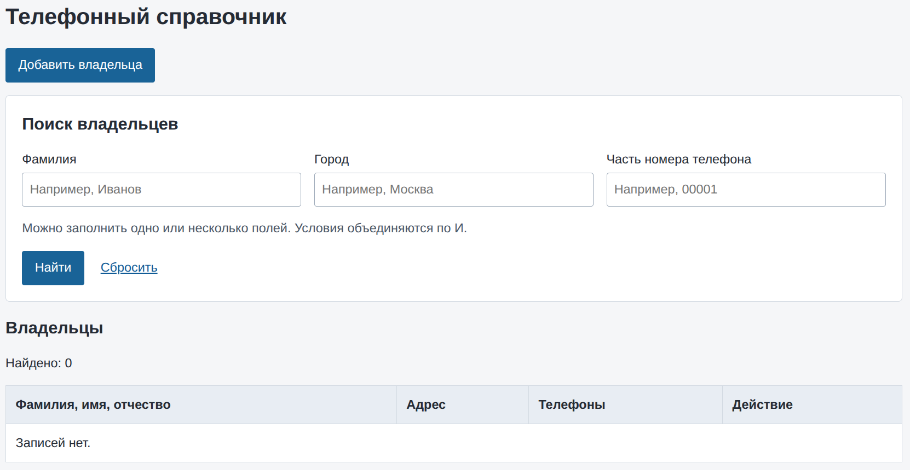
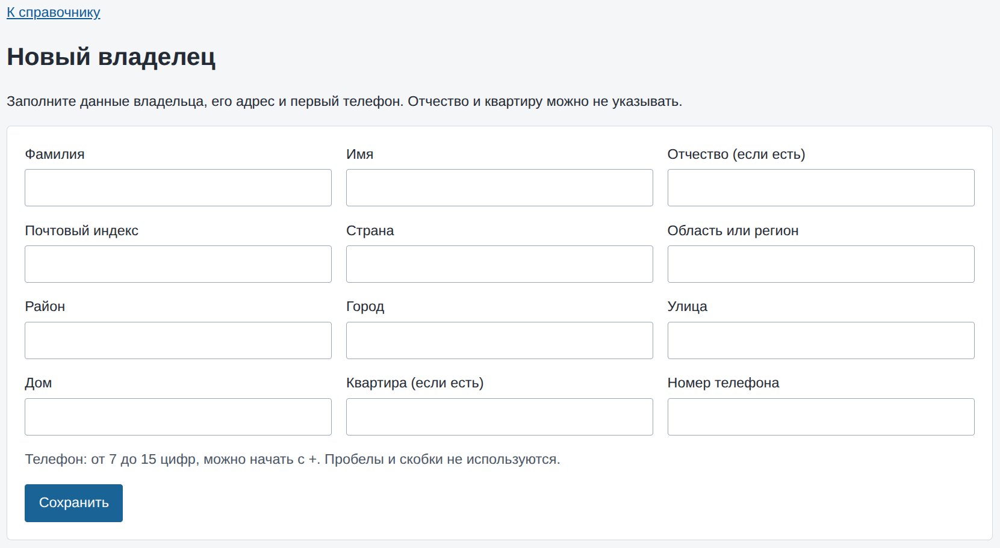

# Лабораторная работа № 3 - Java Persistent API

## Цель работы

Разработать веб-приложение для ведения телефонного справочника. Приложение должно позволять добавлять владельцев с адресом и телефонами, просматривать подробную информацию и искать записи по фамилии, городу или части номера.

## Архитектура проекта

- **Стек:** Java 21, Spring Boot 3.5.16, Maven, Spring Web, Thymeleaf, Spring Data JPA, Bean Validation, H2.
- **СУБД:** H2 в файловом режиме (`jdbc:h2:file:./data/phonebook`). Схема создаётся и обновляется автоматически. Начальные записи и демонстрационные данные отсутствуют.
- **Основные слои:**
  - `OwnerController` - принимает HTTP-запросы, связывает данные с формами и передаёт результаты в Thymeleaf-шаблоны;
  - `OwnerService` - выполняет поиск, создание владельца и добавление телефона в рамках транзакций;
  - `OwnerRepository` - расширяет `JpaRepository`, содержит JPQL-запрос для поиска и загружает адрес и телефоны вместе с владельцем;
  - `Owner`, `Address`, `Phone` - JPA-сущности владельца, адреса и телефонного номера;
  - `OwnerForm`, `PhoneForm`, `SearchForm` - модели форм с правилами серверной валидации;
  - `templates` - страницы списка, создания владельца и подробной информации; `static/style.css` содержит оформление.
- **Ключевые аннотации:** `@SpringBootApplication` запускает приложение; `@Entity`, `@Id`, `@GeneratedValue`, `@OneToOne`, `@OneToMany` и `@ManyToOne` описывают сущности и связи; `@Controller`, `@GetMapping`, `@PostMapping`, `@PathVariable` и `@ModelAttribute` связывают обработчики с запросами и шаблонами; `@Valid`, `@NotBlank`, `@Size` и `@Pattern` проверяют входные данные; `@Service`, `@Transactional` и `@EntityGraph` определяют сервисный слой и загрузку связанных данных.

## Алгоритм работы

1. При открытии `/` отображается список владельцев, форма поиска и количество найденных записей. Если данных нет, страница показывает сообщение «Записей нет».
2. Поиск выполняется по фамилии, городу и части номера телефона. Поля можно комбинировать, условия объединяются по И; фамилия и город ищутся без учёта регистра.
3. Для создания записи пользователь открывает `/owners/new`, заполняет сведения о владельце, адрес и первый телефон. POST-запрос `/owners` проверяет данные и сохраняет владельца, адрес и телефон одной транзакцией.
4. После успешного сохранения приложение перенаправляет на `/owners/{id}`, где показаны адрес и все телефоны владельца. Для несуществующего идентификатора возвращается статус 404.
5. Дополнительный телефон добавляется через форму на странице владельца. POST-запрос `/owners/{id}/phones` проверяет номер и сохраняет его для выбранной записи.
6. Фамилия, имя, страна, регион, район, город, улица, дом, почтовый индекс и первый телефон обязательны. Отчество и квартира могут быть пустыми. Имена допускают буквы, пробелы, дефисы и апострофы; индекс содержит от 3 до 12 букв, цифр, пробелов или дефисов; телефон содержит от 7 до 15 цифр и может начинаться с `+`.
7. При ошибках валидации форма отображается повторно с введёнными значениями и сообщениями об ошибках. Пробелы в начале и конце строковых значений удаляются до проверки.

## Скриншоты работы приложения

### Список владельцев

### Форма добавления владельца

